  <h1>👨🏻‍💻 João Vitor</h1>
  <h3>Desenvolvedor Python Júnior · APIs, Automação e IA Aplicada</h3>

  
Construo APIs, automações e ferramentas com IA que tiram trabalho manual das pessoas — e confiro cada resultado antes de entregar.

---

### Sobre mim

- 🏛️ Desenvolvo sistemas e painéis de dados na Diretoria de TI da Secretaria de Educação de Minas Gerais (rede estadual, 47 regionais)
- 🤖 Uso agentes de IA (Claude Code, MCP) no dia a dia — com testes e revisão de tudo o que é gerado
- 🧪 Projetos com testes em pytest e CI no GitHub Actions; Docker no painel-escolas-fastapi
- 💡 Buscando vaga de Desenvolvedor Python / Back-End / Automação / IA júnior
- 📫 joaovitorg.dev@gmail.com

---

### 🚀 Projetos em destaque

- 🧠 [segundo-cerebro-ia](https://github.com/joaovitorgdev/segundo-cerebro-ia) — memória de longo prazo para Claude Code e Codex via hooks: busca TF-IDF própria (Python puro) e notas Obsidian. pytest + CI.
- ⚙️ [painel-escolas-fastapi](https://github.com/joaovitorgdev/painel-escolas-fastapi) — API REST com FastAPI: validação Pydantic, controle de revisão (HTTP 409), uploads com limites, Docker e CI.
- 🗺️ [atlas-escolar-demo](https://github.com/joaovitorgdev/atlas-escolar-demo) ([demo ao vivo](https://joaovitorgdev.github.io/atlas-escolar-demo)) — ETL de planilhas para SQLite e site estático com mapa 3D; dados fictícios.
- 🎬 [pipeline-video-ia](https://github.com/joaovitorgdev/pipeline-video-ia) — roteiro em JSON, narração TTS, legendas com faster-whisper, render com ffmpeg e publicação com Playwright. 53 testes sem rede.

---

### 🛠️ Tecnologias

  

---

### 📊 Minhas Estatísticas

  

---

### 📫 Onde me encontrar

  
  

---

  <picture>
    <source media="(prefers-color-scheme: dark)" srcset="https://raw.githubusercontent.com/joaovitorgdev/joaovitorgdev/output/pacman-contribution-graph-dark.svg">
    <source media="(prefers-color-scheme: light)" srcset="https://raw.githubusercontent.com/joaovitorgdev/joaovitorgdev/output/pacman-contribution-graph.svg">
    
  </picture>

